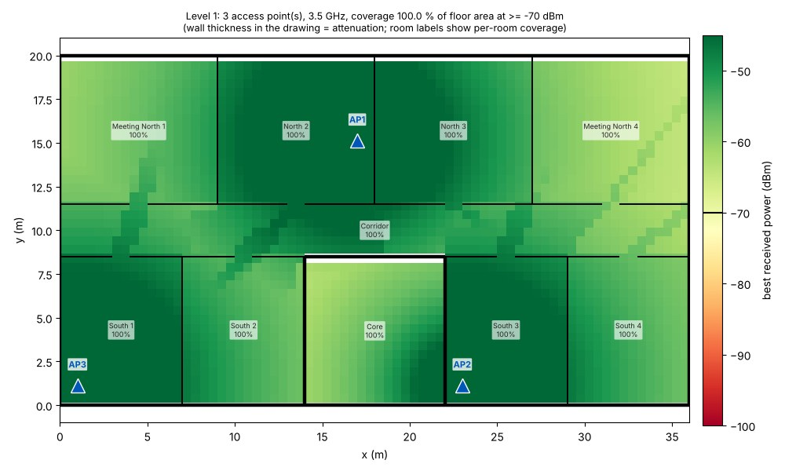
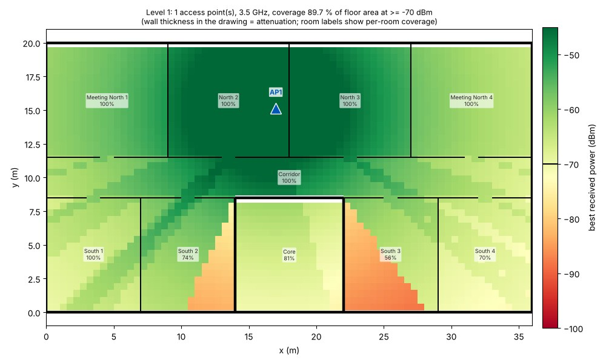
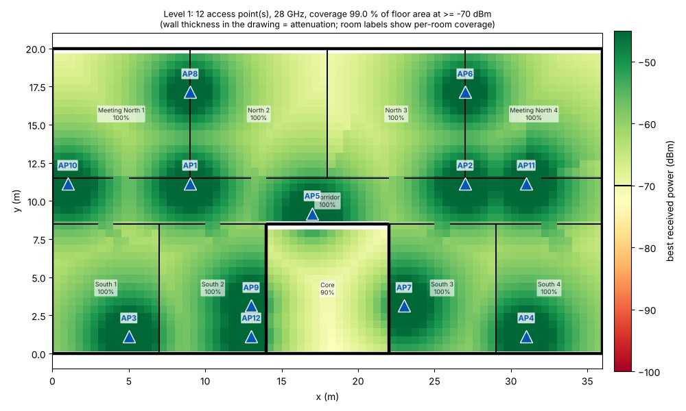

# site-5g-planner

Read a **BIM building model (IFC file)** and work out **where to put indoor 5G access
points** so every room gets a usable signal - using a transparent, wall-aware radio
propagation model and a greedy placement algorithm.

```
$ site5g plan examples/sample_office.ifc
Level 1: 3 AP(s), coverage 100.0 %, worst room 100 % - goals met
```



*Sample office floor (36 m x 20 m, generated by this repo): 3 access points at 3.5 GHz.
Green = signal above the -70 dBm target. Thick black walls = concrete (high attenuation),
thin = plasterboard. Notice the narrow green streaks leaking through the 1 m doorways.*

---

## Table of contents

1. [Why this project exists](#1-why-this-project-exists)
2. [The ideas, explained from zero](#2-the-ideas-explained-from-zero)
3. [Quick start](#3-quick-start)
4. [How it works, step by step](#4-how-it-works-step-by-step)
5. [Experiments and what they show](#5-experiments-and-what-they-show)
6. [Using your own building model](#6-using-your-own-building-model)
7. [Project layout and tests](#7-project-layout-and-tests)
8. [Status and honest limits](#8-status-and-honest-limits)
9. [Roadmap](#9-roadmap)
10. [Questions you should be able to answer after this project](#10-questions-you-should-be-able-to-answer-after-this-project)
11. [References and licence](#11-references-and-licence)

---

## 1. Why this project exists

**The idea:** construction and 5G planning meet in the *building model*. A BIM model
already knows where every wall is and what it is made of - exactly the information a radio
planner needs. A planning tool that reads the model directly can answer "how many access
points does this floor need, and where?" before the building (or the next construction
phase) exists.

**Why Nokia would care:** Nokia sells private 5G / "digital automation" networks to
industries including construction. A Nokia blog post, *"Taking construction to the intelligent
edge with private wireless"* (3 Sep 2021), describes a YIT construction site in Tampere and says
site connectivity can be planned around the building's site plan, the actual construction
phases and the BIM models, with coverage added as the site progresses. This repo is a small,
open, from-scratch version of that planning step. (It is **not** Nokia's method or tooling - it
is a learning project built on the same idea.)

**Skills it trains:** parsing IFC/BIM with `ifcopenshell`, computational geometry (segment
intersection, polygons), radio link budgets and path loss, a greedy optimisation algorithm,
vectorised NumPy, testing numerical code, a CLI.

## 2. The ideas, explained from zero

**BIM and IFC.** *Building Information Modelling* means architects and engineers describe a
building as a database of objects, not drawings. **IFC** (Industry Foundation Classes) is the
open file format for it. An IFC file contains objects such as `IfcWall`, `IfcSlab`, `IfcSpace`
(a room), `IfcBuildingStorey` (a floor), each with 3-D geometry, a *material*, and a place in
the hierarchy Project > Site > Building > Storey > elements.

**Decibels and dBm.** Radio power spans enormous ranges, so we use logarithms. **dB** is a
ratio (+3 dB = double, +10 dB = ten times). **dBm** is power relative to 1 milliwatt:
0 dBm = 1 mW, 23 dBm = 200 mW, -70 dBm = 0.1 nanowatt. Subtracting a loss in dB from a power in
dBm just works - that is why radio engineers love it.

**Link budget.** What reaches the phone:

```
received power (dBm) = transmit power (dBm) + antenna gain (dBi) - path loss (dB)
```

**Path loss** is how much the signal weakens between antenna and phone. This repo uses

```
path loss = FSPL(1 m) + 10 * n * log10(distance in metres) + sum of wall losses on the way
```

* `FSPL(1 m)` - *free-space path loss* at a 1 m reference distance: `20*log10(4*pi*f/c)`,
  about **43.3 dB at 3.5 GHz** and 61.4 dB at 28 GHz. Higher frequency = more loss, always.
* `n` - the **path-loss exponent**. 2 = empty space; indoors people use roughly 2-3, more
  with furniture, machinery and people. Each doubling of distance costs `3n` dB.
* **Wall losses** - every wall the straight line from antenna to phone crosses adds a fixed
  attenuation that depends on its material (concrete is much worse than plasterboard).

**Coverage.** A spot is *covered* when the best access point delivers at least a required
power (default -70 dBm). Coverage = covered area / required area. The tool requires coverage
overall **and** in every single room, because an overall average can hide one bad room
(experiment 1 below shows exactly that).

**Greedy placement.** Computing the best set of access points exactly is a hard (NP-hard)
combinatorial problem. The greedy algorithm repeatedly adds the single access point that
newly covers the most uncovered area. Simple, fast, and a classic with a provable guarantee
for plain coverage problems.

## 3. Quick start

Requirements: Python >= 3.10 (developed and tested on 3.13). `ifcopenshell` and `shapely` ship
wheels, so `pip` is enough.

```bash
git clone https://github.com/Entorkrasniqi/site-5g-planner.git
cd site-5g-planner
python3 -m venv .venv && source .venv/bin/activate
pip install -e ".[dev]"

pytest -q                                          # 29 tests, a few seconds
site5g inspect examples/sample_office.ifc          # what did the loader understand?
site5g plan examples/sample_office.ifc --out out   # place APs, write out/coverage_Level_1.png + plan.json
site5g plan examples/sample_office.ifc --freq 28 --max-aps 20 --out out28
site5g sample my_office.ifc                        # regenerate the sample model
```

`site5g inspect` prints every wall with its length, thickness, material and the attenuation the
tool assigned - **always run it first** on a new model:

```
== Level 1 (elevation 0 m): 28 walls, 10 spaces
  Ext S                         36.00 m  t=0.30 m   12.0 dB  [Concrete]
  South partition x=7            8.50 m  t=0.10 m    3.0 dB  [Gypsum board]
  ...
```

Options for `plan`: `--freq` (GHz), `--tx-power` (dBm), `--exponent`, `--threshold` (dBm),
`--target` (overall coverage), `--min-room` (per-room coverage), `--grid`, `--candidate-spacing`,
`--max-aps`, `--materials my_table.json`, `--storey NAME`, `--format png|jpg|svg`.

## 4. How it works, step by step

```
 building.ifc
     |
     | 1. ifc_loader.load_ifc       triangulate every IfcWall in world coordinates,
     v                              fit a thick line segment, read its material
 walls (segment, thickness, material -> dB)  +  rooms (IfcSpace -> floor polygon)
     |
     | 2. planner.plan_storey       receiver grid (0.5 m) over the rooms
     v                              candidate AP grid (2 m) inside the rooms
 for EVERY candidate AP and EVERY receiver cell:
     |                              propagation.wall_loss_db  (segment-vs-wall tests)
     |                              propagation.path_loss_db   (distance term)
     v
 power matrix  [candidates x cells]
     |
     | 3. greedy loop               pick the AP that newly covers the most cells, repeat
     v                              until overall >= target AND every room >= min_room
 chosen APs + best-server power map + per-room coverage
     |
     | 4. viz / cli                 heat-map figure, plan.json
```

* **Step 1 - reading walls.** IFC stores geometry in many forms, so the loader asks
  `ifcopenshell` to triangulate each wall into world coordinates, then takes the top-view (x, y)
  points and fits a line with principal-component analysis: direction = main axis, centre-line =
  extent along it, thickness = spread across it. Material names such as "Concrete" or
  "Gypsum board" are matched against a keyword table (`materials.py`).
* **Step 2 - wall crossings.** For each AP -> cell line the code tests intersection against
  every wall centre-line (vectorised cross-product test, explained in the docstring of
  `propagation.wall_loss_db`), and adds the attenuation of each wall crossed.
* **Step 3 - greedy.** `planner.plan_storey`. If no candidate covers any new cell it falls back to
  a smooth score so APs still move weak spots towards the threshold.
* **Safety valve:** APs are never placed inside rooms named like "core", "shaft", "stair", "lift"
  (you cannot mount an access point in a lift shaft), though those rooms must still be covered.

## 5. Experiments and what they show

All numbers come from the sample floor and default settings (`--tx-power 23`, `--exponent 3.0`,
`--threshold -70`, 0.5 m grid). Reproduce with the commands in section 3.

### Experiment 1 - the overall average can hide a bad room

With only **one** access point (`--max-aps 1`):



Overall coverage looks respectable (89.7 %), but room "South 3" is at **56 %**: the concrete
core casts a radio shadow (orange/red wedge). This is why the planner insists on a per-room
minimum as well as an overall target.

### Experiment 2 - how many access points? It depends strongly on frequency

| Carrier | Access points needed | Coverage after each AP added |
|---|---:|---|
| 3.5 GHz (mid-band) | 3 | 89.7 %, 97.7 %, 100 % |
| 6 GHz | 3 | 83.0 %, 94.4 %, 100 % |
| 28 GHz (mmWave) | 12 | 35.5 %, 69.0 %, 76.0 %, 83.0 %, 87.3 %, 90.7 %, 93.6 %, 96.3 %, 98.5 %, 98.7 %, 98.9 %, 99.0 % |



This reproduces a well-known real-world fact: **higher carrier frequency means smaller cells and
more access points.** One caveat that makes the real gap *larger*: in this experiment only the
free-space term changes with frequency. Real walls also attenuate more at higher frequencies,
and this repo keeps wall losses fixed at their (placeholder) 3.5 GHz values.

### Experiment 3 - doorways matter

The thin green streaks through the 1 m gaps in the corridor walls are not decoration: rays
passing through the gap cross no wall at all. In the model a doorway is just a gap (no door
objects yet - roadmap P1), but it is enough to show how openings dominate indoor radio
propagation.

## 6. Using your own building model

```bash
site5g inspect path/to/building.ifc
```

Check in that output:

1. **Walls found?** Only `IfcWall` (and subtypes such as `IfcWallStandardCase`) are read.
   Curtain walls, columns, slabs and doors are ignored for now.
2. **Materials recognised?** Walls with no matching keyword get a default 6 dB and are flagged.
   Provide your own table:
   ```json
   { "concrete": 20.0, "brick": 10.0, "glass": 6.0, "insulation": 2.0 }
   ```
   and pass `--materials my_table.json`. **Values should come from measurements or a
   published survey for your frequency** - the built-in numbers are placeholders.
3. **Rooms found?** If the model has `IfcSpace` objects the tool covers exactly those. Without
   them it falls back to the convex hull of all walls (coarse).
4. **Sensible lengths?** Coordinates are expected in metres after `ifcopenshell` conversion.
   A 400-metre wall in a house model means a unit problem.

> **Tested only on the IFC4 file generated by this repo** (`examples/sample_office.ifc`).
> Real-world exports from Revit, ArchiCAD and others are messier - making the loader robust
> on them is roadmap item P1, and probably where you will learn the most.

## 7. Project layout and tests

```
site-5g-planner/
|-- pyproject.toml
|-- examples/sample_office.ifc       generated 36 x 20 m office floor (28 walls, 10 rooms)
|-- src/site5g/
|   |-- materials.py                 keyword -> dB table (PLACEHOLDER values) and lookup
|   |-- ifc_loader.py                IFC -> walls (segment, thickness, material) + rooms
|   |-- propagation.py               FSPL, path loss, vectorised wall-crossing loss
|   |-- planner.py                   receiver grid, candidate grid, greedy placement, goals
|   |-- sample_ifc.py                generator for the example IFC (also a nice ifcopenshell tutorial)
|   |-- viz.py                       heat-map figure
|   `-- cli.py                       `site5g sample | inspect | plan`
|-- tests/                           29 pytest tests
|-- docs/                            figures used in this README
`-- .github/workflows/ci.yml
```

What the tests establish:

| Area | Examples |
|---|---|
| Radio maths | FSPL equals the textbook formula `32.44 + 20log10(f_MHz) + 20log10(d_km)`; +6.02 dB per frequency doubling; +3n dB per distance doubling; distances < 1 m clamped |
| Wall crossing geometry | a crossing counts once; a ray that stops short, passes beside the wall's end, or runs parallel is not attenuated; walls add up per cell |
| IFC loading | a rotated 10 m x 0.2 m wall is recovered exactly; all 28 walls and 10 rooms found; thickness, material and attenuation correct; custom material tables take effect |
| Planner | a small open room needs 1 AP; a wall of 60 dB splits a hall into two APs; goals are met on the sample floor; coverage never decreases when an AP is added; AP budget respected; no AP in the lift core; 28 GHz needs more APs than 3.5 GHz |
| CLI | sample -> inspect -> plan pipeline, unmet goals reported, friendly error for a missing file |

## 8. Status and honest limits

**Works and is tested (v0.1):** everything above, on the generated sample model (Python 3.13,
ifcopenshell 0.9, numpy 2.5, shapely 2.x; 29 tests pass locally).

**Limits - say these out loud if you present this project:**

* **The wall attenuation numbers are illustrative placeholders, and the model has not been
  validated against any real measurement.** It reproduces qualitative behaviour (shadow
  behind concrete, more APs at high frequency); it does not predict real dBm values.
* "Received power" is not 3GPP RSRP/SINR. There is **no interference or capacity model**: the
  tool answers "is there signal?", not "is there throughput?".
* Single storey at a time; no floor/ceiling loss; 2-D straight-line rays; no reflections or
  diffraction; doors are gaps, windows are ignored.
* Straight walls only; curved walls are approximated by one segment.
* Greedy placement is not guaranteed optimal (roadmap P3 measures the gap).
* Loader tested only on its own generated IFC4 file.

## 9. Roadmap

| # | Milestone | You will learn | Done when |
|---|---|---|---|
| P1 | **Robust loader**: real-world IFC (units, curtain walls, openings as doors/windows with their own attenuation, IFC2x3 vs IFC4) | BIM data reality | 3 public IFC models load with correct wall counts verified by eye in a viewer; a regression test for each |
| P2 | **Multi-storey**: floor/ceiling loss between levels; plan the whole building | 3-D geometry | APs on one floor provide (attenuated) coverage on the floor above in the model; test |
| P3 | **Exact solver** for small cases (set-cover as an integer program with `scipy.optimize.milp`) and compare with greedy | optimisation | table: greedy vs optimal AP count on 20 random layouts |
| P4 | **Calibration**: fit path-loss exponent and per-material loss to measurement points (CSV) by least squares | model fitting | RMS error on a held-out measurement set reported in the README |
| P5 | **Standard model option**: 3GPP TR 38.901 Indoor-Office path loss | reading standards | `--model 3gpp-inh` reproduces tabulated values within 0.5 dB |
| P6 | **SINR and capacity**: interference from other APs, throughput estimate from SINR | cellular fundamentals | map of estimated throughput, not just signal |
| P7 | **Write the plan back into the BIM model** as `IfcCommunicationsAppliance` objects | BIM authoring | the output IFC opens in a viewer with APs at the planned positions |
| P8 | **Construction phases**: plan a sequence of models (foundation -> frame -> interior) and show the cumulative AP rollout | the construction angle | CSV of AP counts per phase for 3 synthetic phases |

## 10. Questions you should be able to answer after this project

1. What is the difference between dB, dBm and dBi?
2. Why does doubling the distance cost `3n` dB, and what does `n` represent?
3. Why is 28 GHz harder to cover indoors than 3.5 GHz? Name two reasons (one is in the model, one is not).
4. Why check coverage per room as well as overall?
5. How does the segment-intersection test work, and what are its blind spots (corner hits, rays along a wall)?
6. How does the loader turn a 3-D wall mesh into a line and a thickness? When does that fail?
7. Why is the greedy algorithm not optimal? Give a small counter-example.
8. What would you need to turn "signal power" into "throughput"?
9. Which assumption in this model would you challenge first, and how would you measure it?

## 11. References and licence

* Nokia blog, *Taking construction to the intelligent edge with private wireless* (3 Sep 2021):
  <https://nokia.com/blog/taking-construction-to-the-intelligent-edge-with-private-wireless>
* IfcOpenShell documentation and the `ifcopenshell.api` guide: <https://ifcopenshell.org>
* buildingSMART International, *Industry Foundation Classes (IFC)* specification (search for "buildingSMART IFC" for the current official documentation).
* 3GPP TR 38.901, *Study on channel model for frequencies from 0.5 to 100 GHz* (indoor-office
  scenario; roadmap P5).
* Free-space path loss: any radio-propagation text, e.g. T. Rappaport, *Wireless Communications:
  Principles and Practice*.
* Greedy set cover guarantee: V. Chvatal, "A greedy heuristic for the set-covering problem", 1979.

MIT licence - see [`LICENSE`](LICENSE).
# site-5g-planner
