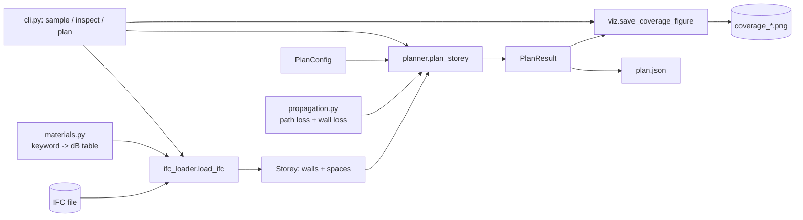
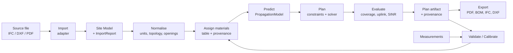

# Architecture

Status: **v0.1 is implemented** (sections 2 and 3 describe it exactly). Sections 4 onward describe the
**target architecture**; it is a design to be built incrementally, not existing code. Decisions are
recorded in [adr/](adr/README.md).

## 1. Architectural drivers

The design follows from what integrators need ([product.md](product.md)) and the qualities in
[requirements.md](requirements.md). In priority order:

1. **Trust and auditability.** Every result must be reproducible and explain its assumptions (NFR-01, 08, 13).
2. **Replaceable radio model.** The propagation model is the part most likely to change and the part customers will challenge (FR-10, 13).
3. **Messy real inputs.** IFC from real projects is inconsistent, and some customers have no BIM at all (FR-01, 02, 07).
4. **Scriptable first, UI second.** Integrators automate; the CLI, API and UI must be thin clients over one core (FR-50, 51, 52).
5. **Bounded cost.** Runtime and memory must not explode on large floors (NFR-02, 03).
6. **Safe handling of untrusted, confidential files** (NFR-05, 06, 07).

## 2. Current system (v0.1, implemented)

A single Python package, `site5g`, about 740 lines, run as a CLI.



| Module | Responsibility | Notes |
|---|---|---|
| `ifc_loader.py` | IFC -> `Storey`, `Wall`, `Space` using ifcopenshell triangulation in world coords, PCA line-fit per wall | Straight walls only; skips failures silently (gap) |
| `materials.py` | Keyword -> dB table, substring match, layered walls add up | Values are placeholders |
| `propagation.py` | `fspl_1m_db`, `path_loss_db`, vectorised segment-intersection `wall_loss_db` | Log-distance + sum of walls crossed; 2-D |
| `planner.py` | `PlanConfig`, grid of receiver cells and candidate APs, dense power matrix, greedy max-coverage with per-room goals | O(candidates x cells x walls) time, O(candidates x cells) memory |
| `viz.py` | Matplotlib heatmap | Presentation only |
| `sample_ifc.py` | Generates the demo building | Test fixture generator |
| `cli.py` | Argument parsing and orchestration | Writes `plan.json` and images |

What is already good and must be preserved: pure functions with explicit units in names, vectorised
numerics, small dataclasses, a loader separated from the planner, tests at module level.

What blocks the target product: the loader's output type is the planner's input type (so IFC quirks
leak everywhere), the model is hard-wired, the artifact has no provenance, and nothing is isolated
from untrusted input.

## 3. Quality-attribute assessment of v0.1

| Attribute | State | Evidence |
|---|---|---|
| Determinism | Probably deterministic (numpy argmax tie-break is first index) but untested | No golden test |
| Provenance | Weak | `plan.json` holds config only |
| Failure handling | Weak | Silent `except Exception: continue` in loader |
| Performance | Unmeasured; known to be super-linear | See section 8 |
| Testability | Good | 29 tests, pure functions |
| Extensibility of model | Poor | `received_power_dbm` calls `path_loss_db` directly |

## 4. Target architecture: principles

1. **Ports and adapters (hexagonal).** The core (domain + planning) has no I/O, no IFC, no HTTP, no plotting. Everything external is an adapter behind a small interface. See [ADR-0006](adr/0006-api-first-thin-clients.md).
2. **A canonical internal Site Model** decouples input formats from the planner. IFC is one importer. See [ADR-0002](adr/0002-canonical-site-model.md).
3. **Propagation models are plug-ins** behind one interface. See [ADR-0003](adr/0003-pluggable-propagation-model.md).
4. **The plan is an immutable, versioned, provenance-carrying artifact.** It is the integration contract. See [ADR-0005](adr/0005-plan-artifact-contract.md).
5. **Stages communicate through data, not shared state.** Each stage is a pure function from versioned input to versioned output, so it can be cached, tested and re-run alone.
6. **Fail loudly and structurally.** Warnings and errors are data (codes + context), collected into reports, never swallowed.

## 5. Target logical architecture

```mermaid
flowchart TB
    subgraph Clients
        CLI[CLI]
        WEB[Web UI]
        SCRIPT[Customer scripts / CI]
    end
    subgraph Service["Application layer (use cases)"]
        API[HTTP API]
        UC[Use cases: Import, Plan, Validate, Calibrate, Export]
        JOBS[Job runner / queue]
    end
    subgraph Core["Core (pure, no I/O)"]
        SM[Site Model]
        PM[Propagation models<br/>simple-wall | 3GPP InH | calibrated | ray-tracing later]
        PLN[Planner<br/>greedy | exact | local search]
        VAL[Validation + calibration]
        PA[Plan artifact + provenance]
    end
    subgraph Adapters
        IFCA[IFC importer]
        PLAN2D[Floor-plan / DXF importer]
        MEAS[Measurement CSV importer]
        CAT[Equipment catalogue]
        EXP[Exporters: JSON, CSV BOM, PDF, IFC write-back, DXF, images]
        STORE[(Project store: files + metadata)]
    end
    CLI --> UC
    SCRIPT --> API
    WEB --> API
    API --> UC
    UC --> JOBS
    JOBS --> Core
    UC --> Adapters
    Adapters --> Core
    Core --> Adapters
```

Dependency rule: arrows point inward. `Core` imports nothing from `Adapters` or `Service`.
Enforce with an import-linter check in CI (see [contributing.md](contributing.md)).

## 6. Pipeline and stages



Each stage has a typed input and output. Stages are cacheable on a content hash of their inputs
(source file SHA-256, parameters, model id/version). Calibration feeds back into the material table
(`E`) as a new versioned table, never by mutating the old one.

## 7. Key interfaces (sketch, target)

These are contracts, not final code.

```python
class Importer(Protocol):
    def load(self, source: Path) -> tuple[SiteModel, ImportReport]: ...

class PropagationModel(Protocol):
    id: str
    version: str
    def received_power_dbm(self, tx: Transmitter, rx_points: Points, site: SiteModel) -> np.ndarray: ...
    def uncertainty_db(self, tx: Transmitter, rx_points: Points, site: SiteModel) -> np.ndarray: ...

class Planner(Protocol):
    def plan(self, site: SiteModel, model: PropagationModel,
             catalogue: Catalogue, goals: Goals, constraints: Constraints) -> Plan: ...
```

Design rules for these:

* Inputs and outputs are immutable dataclasses; arrays are NumPy with documented shape and unit.
* A model declares its **valid range** (frequency, distance, environment); using it outside raises a visible warning.
* `ImportReport` and `Plan.warnings` are lists of structured items `{code, severity, element_ref, message}`.

## 8. Performance and scalability

Back-of-envelope, to be replaced by measurements (NFR-02, 03).

* v0.1 sample floor: 720 m2 at 0.5 m is about 2,900 cells, a few hundred candidates, about 28 walls. Trivial.
* Large floor: 10,000 m2 gives about 40,000 cells, about 2,500 candidates (2 m spacing) and several hundred walls.
  The power matrix alone is 2,500 x 40,000 x 8 B = about 800 MB, and the segment-intersection test is
  on the order of 2,500 x 40,000 x 400 = 4 x 10^10 pair tests. That is minutes to tens of minutes and gigabytes: not acceptable for interactive use.

Planned mitigations, in order of payoff:

1. **Spatial index** for walls (grid or R-tree): test each ray only against nearby walls (typically 10-100x fewer).
2. **Float32 and chunking** over candidates so memory is bounded; keep only coverage bitmasks per candidate, not the full power matrix.
3. **Coarse-to-fine**: coarse grid for candidate selection, fine grid for final evaluation.
4. **Lazy evaluation of candidates** (lazy greedy exploits submodularity: stale gains are upper bounds, so most candidates need no re-evaluation).
5. **Parallelism** over candidates (process pool); deterministic reduction order to preserve NFR-01.
6. **Caching** per (site hash, model, AP position) in the service.

Introduce a benchmark suite *first* (see [testing-strategy.md](testing-strategy.md)) so each optimisation is justified by data.

## 9. Security, privacy, and threat model (target service)

Building models of factories, ports and hospitals are sensitive, and file parsers are a classic attack surface.

| Threat | Mitigation |
|---|---|
| Malicious or malformed IFC exploits the native parser (ifcopenshell is C++) | Run import in a **sandboxed worker process** with CPU, memory, wall-clock and file-size limits; no network; non-root; read-only filesystem except a scratch dir |
| Decompression/entity bombs, enormous models | Size and entity-count limits before geometry; timeouts; structured `E_LIMIT_EXCEEDED` |
| Cross-tenant data access | Tenant id on every record; authorisation checks in one layer; tests for cross-tenant denial |
| Leakage of confidential models | Encryption in transit and at rest; signed short-lived download URLs; configurable retention; deletion on request; EU region option |
| Path traversal / zip-slip on uploads | Never use client filenames as paths; content-addressed storage |
| Supply-chain risk | Pinned, hashed dependencies; dependency and licence scanning in CI |
| Result tampering / disputes | Plan artifact carries input hash and tool/model versions; optional signing |
| Denial of service via expensive jobs | Per-tenant quotas and queue limits; cost estimate before run |

Privacy: the product does not need personal data beyond account details; building plans are customer
confidential business data. Define a data-processing agreement template and a retention default early.
This is an engineering plan, not legal advice; legal review is a prerequisite for hosted service.

## 10. Deployment views

* **Phase now to P3: library + CLI**, installed with pip, runs on a laptop. No server.
* **P4: single-node service**: API + worker processes + object storage + relational DB (for projects/metadata). Containerised; one `docker compose` for dev.
* **P5: horizontal**: stateless API replicas, queue-driven workers autoscaled by queue depth, object storage for artifacts.
* **Self-hosted option**: integrators may refuse to upload customer models to a third party; keep the container deployable on-prem. `[hypothesis]` to confirm in interviews.

## 11. Cross-cutting concerns

* **Configuration:** one validated settings object; defaults documented; no hidden globals.
* **Logging and metrics:** structured JSON logs with `job_id`, stage timings, model id; counters for failures by error code.
* **Error taxonomy:** `E_IMPORT_*`, `E_MODEL_*`, `E_PLAN_*`, `E_LIMIT_*`; each has user-facing guidance.
* **Versioning:** package semver; artifact schema version; model version; they are recorded in every plan.
* **Documentation as code:** docs live in the repo; ADRs for decisions; requirements cited from tests.

## 12. Evolution plan (strangler, not rewrite)

1. Introduce `SiteModel` types and make the existing loader produce them (rename, no behaviour change).
2. Wrap `propagation` behind `PropagationModel`; the current formula becomes `simple-wall-v1`.
3. Add provenance and schema to `plan.json`.
4. Add import report and fix the silent failure.
5. Add benchmarks, then the spatial index.
6. Only then add the API and UI on top of the stabilised core.

Each step ships with tests and keeps the CLI working.
