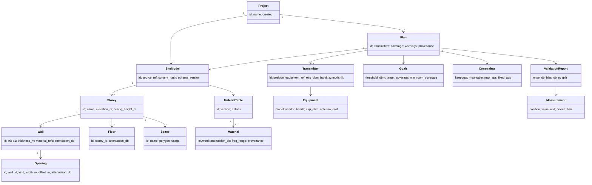

# Domain model

Status: v0.1 types are implemented (`Wall`, `Space`, `Storey`, `PlanConfig`, `PlanResult`). Everything
else is the **target** model. Where the target differs from code, it says so.

## 1. Conventions

* **Coordinates:** metres, right-handed, x east, y north, z up, in the model's local site frame. Storey elevation in metres relative to the project datum.
* **Power:** dBm is absolute power. dB is a ratio. Adding a dB loss to a dBm power is valid; adding two dBm values is not.
* **Frequency:** stored as GHz in configuration (`freq_ghz`); converted to Hz inside formulas. Never pass a bare `float` without the unit in its name.
* **Identity:** every entity has a stable `id`. Imported entities keep the source GUID (IFC `GlobalId`) so results can be mapped back to the source model.
* **Immutability:** domain objects are immutable; changes create a new version.

## 2. Concept map



## 3. Entities and invariants

### Site model

| Entity | Fields (units) | Invariants | State |
|---|---|---|---|
| `Storey` | `name`, `elevation_m`, `walls`, `spaces` | Unique name within model; sorted by elevation | implemented (no ceiling height, floor loss) |
| `Wall` | `guid`, `name`, `p0`, `p1` (m), `thickness_m`, `materials`, `attenuation_db`, `matched_keywords` | `length > 0`; attenuation >= 0; centre-line is a straight segment (approximation) | implemented |
| `Opening` (door/window) | `wall_id`, `kind`, `width_m`, `offset_m`, own `attenuation_db` | Lies within its wall's extent; attenuation replaces the wall's over its width | planned P1 (v0.1: doorways are gaps in geometry, windows ignored) |
| `Floor` / slab | `storey_id`, `attenuation_db` | Applies to rays that change storey | planned P3 |
| `Space` (room) | `guid`, `name`, `polygon` (shapely, m) | Valid, non-self-intersecting, single polygon (largest part kept if the footprint splits) | implemented |
| `Material` | keyword, `attenuation_db`, valid frequency range, **provenance** (placeholder / literature / measured + source) | `attenuation_db >= 0`; frequency range stated | partly (no provenance) |

**Important limitation recorded in the model:** wall attenuation is a single scalar per crossing,
independent of frequency, angle and thickness. This is a modelling simplification, not a property of
reality (see [radio-model.md](radio-model.md)).

### Radio and planning

| Entity | Fields | Invariants | State |
|---|---|---|---|
| `PlanConfig` (target `Goals`+`RadioParams`) | `freq_ghz`, `tx_power_dbm`, `path_loss_exponent`, `threshold_dbm`, `target_coverage`, `min_room_coverage`, `grid_m`, `candidate_spacing_m`, `max_aps`, `exclude_ap_rooms` | `freq_ghz > 0`, exponent in a plausible range, coverage in [0, 1], `grid_m > 0` | implemented, no validation |
| `Transmitter` | `position` (x, y, z m), `equipment_ref`, `eirp_dbm`, band, antenna orientation | Position inside a mountable space or on a mountable surface | planned (v0.1: AP = point in 2-D with fixed power) |
| `Equipment` | vendor, model, supported bands, max EIRP, antenna pattern, mounting, unit cost | EIRP within regulatory limit for the region (user-supplied) | planned P3 |
| `PlanResult` (target `Plan`) | storey, cells, `best_dbm`, `aps_xy`, `coverage_after_each_ap`, `room_coverage` | `coverage_after_each_ap` is **non-decreasing**; `0 <= coverage <= 1`; room coverage keys are unique | implemented, plus planned provenance |

Derived definitions:

* **Cell:** a receiver sample point (square of side `grid_m`, represented by its centre).
* **Covered cell:** best-server received power >= `threshold_dbm`.
* **Coverage:** fraction of cells covered. Area-weighted equivalently, because cells are equal size.
* **Per-room coverage:** same fraction restricted to cells inside that room's polygon.
* **Goals met:** overall coverage >= `target_coverage` **and** every room >= `min_room_coverage`.

### Validation

| Entity | Fields | Invariants |
|---|---|---|
| `Measurement` | `position`, `storey`, `value_dbm`, `quantity` (RSRP/RSSI/other), `device`, `time` | Quantity is explicit; mixing RSRP and RSSI is rejected |
| `ValidationReport` | `rmse_db`, `bias_db`, `n`, `error_histogram`, `split` (train/test definition), `model_id`, `site_hash` | Test points never used in fitting (leakage check) |

## 4. The plan artifact (target contract)

`plan.json` becomes a versioned document, the integration contract with all clients and with the customer's
own tools ([ADR-0005](adr/0005-plan-artifact-contract.md)).

```jsonc
{
  "schema_version": "1.0",
  "provenance": {
    "tool": "site5g", "tool_version": "0.x.y",
    "model": {"id": "simple-wall", "version": "1"},
    "input": {"filename": "office.ifc", "sha256": "..."},
    "material_table": {"id": "...", "sha256": "...", "provenance": "placeholder"},
    "validated": {"status": "not-validated"}        // or {"sites": 4, "rmse_db": 5.2}
  },
  "config": { "freq_ghz": 3.5, "threshold_dbm": -70.0 },
  "storeys": [{
    "name": "Level 1",
    "access_points": [{"x_m": 17.0, "y_m": 15.15}],
    "coverage": 1.0,
    "coverage_after_each_ap": [0.8972, 0.9774, 1.0],
    "room_coverage": {"South 1": 1.0},
    "goals_met": true
  }],
  "warnings": [{"code": "W_PLACEHOLDER_ATTENUATION", "severity": "warn", "message": "..."}]
}
```

Rules: no wall-clock timestamps inside the identity hash (determinism); unknown fields are preserved
by readers; breaking changes bump the major `schema_version` (NFR-14).

## 5. Known domain simplifications (v0.1)

* Single storey; no vertical propagation; APs are 2-D points (no mounting height).
* Receiver height and body loss are not modelled.
* One frequency, one power, one omni pattern for every AP.
* "Coverage" means received power above a threshold; it is **not** 3GPP RSRP/SINR and is not throughput.
* Doors are only gaps if the geometry has a gap; windows are ignored.
* Curved and L-shaped walls become one straight segment.
