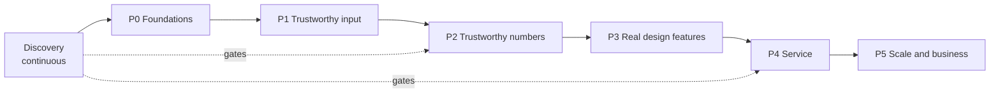

# Roadmap

Status: proposal. Order is driven by one idea: **an integrator will not use a planning tool they cannot
trust**, so trust (input fidelity, validated numbers, auditability) comes before breadth and polish.
This reorders and extends the original P1-P8 list in the main README; the mapping is in section 4.

Time estimates are deliberately absent: with a single maintainer and unvalidated demand they would be
fiction. Each phase is closed by **exit criteria**, not by a date.

## 1. Phases at a glance

## 2. Phase details

### Discovery (runs alongside P0-P2)

8-10 interviews and 3 design partners ([product.md](product.md) section 8).
**Exit:** written findings; each decision gate in product.md resolved; list of 3 partners with data-sharing terms; first real IFC models and measurements received.

### P0 Foundations (harden the baseline)

Fix the engineering base before adding features.

* Provenance and schema for `plan.json`: tool version, input SHA-256, parameters, material table, validation status (FR-30, NFR-08).
* Determinism test and golden `plan.json` (NFR-01).
* CI matrix covers every declared Python version and Linux/macOS/Windows (NFR-09).
* Lint, format, type check, coverage reporting, import-boundary check (NFR-10).
* Benchmark harness with synthetic sites; first measured numbers for NFR-02/03.
* Introduce `SiteModel` type names and `PropagationModel` interface as pure refactors ([architecture.md](architecture.md) section 12), no behaviour change.
* Decide and record ADRs 0001-0007.

**Exit:** all gates green in CI; benchmark baseline recorded; `plan.json` validates against a published schema; zero behaviour change in sample plan (golden test proves it).

### P1 Trustworthy input

Make real-world IFC import dependable and honest.

* Import report; no silent skipping (FR-02).
* Doors and windows as openings (FR-03); units and elevations (FR-04); curtain/curved walls approximated and reported (FR-05).
* Editable, versioned material table with provenance (FR-06).
* IFC regression corpus of >= 3 public models per schema, fuzz tests (NFR-05).
* IFC2x3 and IFC4 support (FR-01).

**Exit:** corpus models load with wall and room counts matching a viewer in >= 98% of cases; 100% of skipped elements appear in the report; fuzz suite finds no crash or hang; import time recorded.

### P2 Trustworthy numbers

Turn the demo model into something an engineer can defend.

* Model interface with `simple-wall` and `3gpp-inh` (FR-10, 11).
* Measurement import, validation report, and calibration with held-out evaluation (FR-13, 40, 41, 42).
* Uncertainty/fade margin (FR-14).
* Exact-solver benchmark of greedy on small cases (FR-25).
* Validation level L2 reached on at least one real site; L3 target with 3 design partners.

**Exit:** calibrated held-out RMSE and bias reported on >= 3 sites against the targets in NFR-04 (or targets revised with evidence); plans display validation status; greedy-vs-optimal gap table published. **If targets are missed, publish the true numbers and revise the product claims, not the data.**

### P3 Real design features

What an integrator needs to produce a deliverable.

* Multi-storey with floor loss and 3-D distance (FR-12).
* Equipment catalogue, antenna patterns, mounting height (FR-21, 15).
* Constraints: no-go zones, mountable surfaces, fixed APs (FR-22).
* Uplink budget and SINR/indicative capacity (FR-16, 17).
* Scenario comparison (FR-24).
* Deliverables: BOM CSV, PDF report, IFC write-back, DXF/PDF drawings (FR-32 to 35).
* Performance work to meet NFR-02/03 on large floors (spatial index, chunking, lazy greedy).

**Exit:** a design partner produces a full quote package for a real multi-storey site using only the tool plus their review; performance budgets met on the benchmark; deliverables accepted by at least one partner as "usable with minor edits" (their words recorded).

### P4 Service

Make it usable without installing Python.

* HTTP API with OpenAPI contract (FR-51); job runner; sandboxed importer workers (NFR-06).
* Web UI: upload, view, edit model, place/lock APs, compare, export (FR-52, 23, 8).
* Projects and versioning (FR-53); non-BIM input via scaled floor plans (FR-07).
* Security review, data retention and deletion, backups, observability (NFR-06, 07, 11).

**Exit:** time to first plan <= 10 min median in usability sessions (NFR-12); penetration/abuse tests pass; a partner runs a real project end to end in the hosted or self-hosted service.

### P5 Scale and business

* Multi-user, tenants, roles (FR-54); billing if there is demand.
* Construction-phase planning (FR-26) if discovery shows demand.
* Ray-tracing model; optional AI-assisted placement (only with a validated baseline to compare against).
* Support, SLAs, release process, public documentation site.

**Exit:** defined by business evidence from P2-P4 pilots, not set in advance.

## 3. Phase gates

At the end of each phase review:

1. Exit criteria met, with evidence linked.
2. [Requirements](requirements.md) traceability: each requirement completed has a test.
3. [Risks](risks.md) re-scored; new risks added.
4. ADRs updated for decisions made.
5. **Go / pivot / stop** decision, especially after Discovery and P2.

## 4. Mapping from the original README roadmap

| Original | Where now |
|---|---|
| P1 Robust loader | P1 (plus import report, corpus, fuzzing) |
| P2 Multi-storey | P3 |
| P3 Exact solver | P2 (benchmark of greedy) |
| P4 Calibration | P2 |
| P5 3GPP indoor model | P2 |
| P6 SINR and capacity | P3 |
| P7 Write back into BIM | P3 |
| P8 Construction phases | P5 (conditional on discovery) |

New: P0 foundations, discovery, service (P4), uncertainty, equipment catalogue, constraints, uplink,
deliverables, security.

## 5. Explicit deferrals and why

* **AI/ML placement:** only worth it against a trusted baseline; until validation exists it would add complexity and hide errors.
* **Ray tracing:** expensive to build and to validate; revisit if calibrated `simple-wall` cannot meet NFR-04.
* **Outdoor/macro propagation:** different problem, different customers.
* **Billing/multi-tenant:** no point before the product is validated and wanted.
